# Kurbanlık Yönetim Sistemi

Kurban döneminde küçükbaş ve büyükbaş hayvan kayıtlarını, müşteri bilgilerini ve ödeme durumlarını tek bir yerden yönetmek için geliştirilmiş modern bir web uygulaması.

Eski Streamlit/Python tabanlı yapıdan tamamen ayrılarak **Next.js + Supabase** mimarisine taşınmıştır. Mobil uyumlu arayüz, Türkçe form alanları ve kurban operasyonlarına özel iş akışları sunar.

---

## Özellikler

### Genel

- **Dashboard** — Kayıtlı hayvan sayısı, anlaşılan toplam, tahsil edilen tutar ve bekleyen ödeme özeti
- **Giriş koruması** — Cookie tabanlı admin oturumu
- **Karanlık / aydınlık tema** — Tüm sayfalarda tema desteği
- **Mobil uyumlu arayüz** — Alt navigasyon ve responsive kart düzeni

### Küçükbaş (kurbanlık hesap)

- Müşteri ekleme, güncelleme ve silme
- Gelişmiş sorgulama: hayvan numarası, sahip, tür, telefon
- Müşteri listeleme: sıralama, sayfalama, Excel/CSV dışa aktarma
- Grup kategorileri (kesim günü, dağıtım vb.)
- Ödeme durumu takibi: Ödendi, Kısmi Ödeme, Ödenmedi, Belirsiz
- Anlaşılan tutar (`agreed_total`) ve tahsil edilen tutar ayrımı
- Değişiklik geçmişi (`kurbanlik_hesap_history`)

### Büyükbaş

- Hayvan bazlı kayıt (toplam hisse, birim fiyat, hayvan fiyatı)
- Hissedar yönetimi: her hissedar için ayrı ödeme ve iletişim bilgisi
- Büyükbaş sorgulama ve kart görünümü

### Toplu işlemler

- Excel dosyasından toplu küçükbaş ve büyükbaş içe aktarma
- Hatalı satırlar için atlama ve raporlama

### İstatistikler ve Çok Yıllı Analiz

- Küçükbaş ve büyükbaş birleşik özet
- Grup kategorisine göre hayvan sayısı ve tutar dağılımı
- **Çok Yıllı Analiz (`/analiz`)**: Yıllar arası ciro, tahsilat, doluluk oranları ve müşteri sadakat trendleri (Recharts grafikler)
- **Borçlu Listesi Excel Dışa Aktarma**: Çoklu yıl analiz sekmesinde filtreli borçlu dökümü

### Yıllık Sezon Yönetimi (`/sezonlar`)

- **Yıl İzolasyonu**: Her küçükbaş ve büyükbaş kaydı ilgili `sezon_id` ile izole edilir
- **Hızlı Sezon Geçişi**: Üst menüden tek tıkla geçmiş veya aktif yıla geçiş (çerez tabanlı `ks_year`)
- **Sezon Kilitleme/Arşivleme**: Kapatılan sezonlar PostgreSQL trigger seviyesinde yazmaya karşı korunur
- **Geçmiş Müşteri Otomatik Tamamlama**: Yeni yılda müşteri adı yazılırken önceki yılların kayıtlarından otomatik öneri

---

## Teknolojiler

| Katman | Teknoloji |
|--------|-----------|
| Frontend | Next.js 16 (App Router), React 19, TypeScript |
| Stil | Tailwind CSS v4, shadcn/ui, Radix UI |
| Form & doğrulama | react-hook-form, zod |
| Veritabanı | Supabase (PostgreSQL) |
| Tablo & dışa aktarma | TanStack Table, SheetJS (xlsx) |
| Dağıtım | Vercel |

---

## Sistem Mimarisi & Archify Görselleştirmesi

Sistemin uçtan uca mimarisi, [Archify](https://github.com/tt-a1i/archify) formatında modellenmiş ve interaktif HTML raporu olarak derlenmiştir.

### 🌐 İnteraktif Mimariyi Açma
Sistemin interaktif düğümlerini, katmanlarını, veri akışını ve bileşen detaylarını incelemek için oluşturulan HTML çıktısını doğrudan tarayıcınızda açabilirsiniz:
- **İnteraktif HTML Raporu**: [`doc/system-architecture.html`](doc/system-architecture.html)
- **Archify JSON Tanımı**: [`doc/system-architecture.architecture.json`](doc/system-architecture.architecture.json)

Tarayıcıda açmak için terminal komutu:
```powershell
# Windows
start doc/system-architecture.html

# macOS
open doc/system-architecture.html

# Linux
xdg-open doc/system-architecture.html
```

Mimaride değişiklik yapıldığında yeniden derlemek için:
```bash
archify render architecture doc/system-architecture.architecture.json doc/system-architecture.html
```

### 📐 Mimari Şeması (Mermaid)

```mermaid
graph LR
    subgraph ClientLayer["İstemci Katmanı"]
        User["Kullanıcı / Admin Tarayıcı<br/>(Desktop & Mobil)"]
    end

    subgraph NetworkLayer["Ağ & Ağ Geçidi"]
        Proxy["Next.js Reverse Proxy & Routing<br/>(Cookie: ks_year & auth_token)"]
    end

    subgraph AppLayer["Uygulama Katmanı (Next.js 16)"]
        WebUI["Web UI (React 19, Tailwind v4)<br/>- /dashboard, /musteriler, /sorgula<br/>- /sezonlar (Sezon Yönetimi)<br/>- /analiz (Çok Yıllı Recharts Grafikleri)"]
        Actions["Server Actions<br/>- sezonActions (Aktif yıl değişimi, arşiv kilidi)<br/>- customerActions (Küçükbaş CRUD)<br/>- buyukbasActions (Hissedar & hayvan)<br/>- analyticsActions (Çok yıllı metrikler)"]
    end

    subgraph DataLayer["Veri Erişim Katmanı"]
        Client["Supabase TypeScript SDK<br/>(Service Role & Anon Client)"]
    end

    subgraph DBLayer["Veritabanı Katmanı (Supabase PostgreSQL)"]
        Seasons["kurban_sezonlari<br/>(Yıl, durum, kilit, varsayılan)"]
        SmallCattle["kurbanlık_hesap & history<br/>(sezon_id ile izole)"]
        BigCattle["buyukbas_hayvan & hissedar<br/>(sezon_id ile izole)"]
        LockTriggers["PostgreSQL Trigger'ları<br/>(Arşivlenmiş sezon koruması)"]
    end

    User -->|HTTPS İstekleri| Proxy
    Proxy -->|Oturum & Yıl Bilgisi| WebUI
    WebUI -->|Form Gönderimleri & Eylemler| Actions
    Actions -->|Yetkili Veritabanı Sorguları| Client
    Client -->|SQL Sorguları & Filtreler| Seasons
    Client -->|sezon_id Filtreli Sorgular| SmallCattle
    Client -->|sezon_id Filtreli Sorgular| BigCattle
    Seasons -.->|Kilit Kontrolü| LockTriggers
    LockTriggers -.->|Engelleme| SmallCattle
    LockTriggers -.->|Engelleme| BigCattle
```



---

## Proje yapısı

```text
new_query_system/
├── doc/                    # Mimari ve dokümantasyon
│   ├── system-architecture.architecture.json  # Archify mimari tanımı
│   └── system-architecture.html               # Archify interaktif mimari görselleştirmesi
├── web/                    # Next.js uygulaması (aktif kod tabanı)
│   ├── src/
│   │   ├── app/            # Sayfalar (dashboard, müşteriler, sezonlar, analiz, vb.)
│   │   ├── actions/        # Server Actions (auth, müşteri, büyükbaş, sezonlar, analiz)
│   │   ├── components/     # UI bileşenleri (sezon seçici, grafikler, formlar)
│   │   └── lib/            # Supabase, validasyon, yardımcılar
│   └── public/             # Statik dosyalar
├── supabase/
│   ├── migrations/         # Veritabanı migration dosyaları (sezon tabloları ve tetikleyiciler)
│   └── seed.sql            # Örnek test verisi
├── data/                   # Örnek CSV ve görseller
└── package.json            # Kök npm script'leri (web/ yönlendirmesi)
```

---

## Gereksinimler

- **Node.js** 20+
- **npm** 10+
- **Supabase** hesabı ve proje
- (İsteğe bağlı) [Supabase CLI](https://supabase.com/docs/guides/cli) — migration yönetimi için

---

## Kurulum

### 1. Depoyu klonlayın

```bash
git clone https://github.com/emrahsahn/query_system.git
cd query_system
```

### 2. Bağımlılıkları yükleyin

```bash
cd web
npm install
```

Kök dizinden çalıştırmak isterseniz:

```bash
npm install --prefix web
```

### 3. Ortam değişkenlerini ayarlayın

`web/.env.local.example` dosyasını kopyalayarak `web/.env.local` oluşturun:

```bash
cp web/.env.local.example web/.env.local
```

Ardından aşağıdaki değerleri doldurun:

```env
# Supabase — Dashboard → Project Settings → API
NEXT_PUBLIC_SUPABASE_URL=https://xxxxxxxxxxxxxxxxxxx.supabase.co
NEXT_PUBLIC_SUPABASE_ANON_KEY=eyxxxxxxxxxxxxxxxxxxxxxxxxxxxxxxxxxxxx

# Admin giriş bilgileri (üretimde mutlaka değiştirin)
ADMIN_USERNAME=admin
ADMIN_PASSWORD=guclu-bir-sifre

# Oturum imzası (rastgele, uzun bir dize kullanın)
SESSION_SECRET=super-secret-string

# İsteğe bağlı — oturum süresi (saat), varsayılan: 8
SESSION_MAX_AGE_HOURS=8
```

> **Güvenlik:** `ADMIN_PASSWORD` ve `SESSION_SECRET` değerlerini üretim ortamında varsayılan değerlerle bırakmayın.

### 4. Veritabanını hazırlayın

Migration dosyalarını Supabase projenize uygulayın.

**Supabase CLI ile:**

```bash
supabase db push
```

**SQL Editor ile:** `supabase/migrations/` altındaki dosyaları tarih sırasına göre tek tek çalıştırın.

Test verisi yüklemek için:

```sql
-- supabase/seed.sql içeriğini SQL Editor'de çalıştırın
```

> Migration geçmişi çakışması yaşarsanız `supabase/clear_migration_history.sql` dosyasındaki talimatları uygulayın; ardından `db push` işlemini tekrarlayın.

RLS (Row Level Security) politikalarının uygulandığından emin olun — `20260501170000_add_rls_policies.sql` ve büyükbaş migration'ları bunları içerir.

---

## Geliştirme

```bash
# web/ dizininden
npm run dev

# veya kök dizinden
npm run dev
```

Uygulama [http://localhost:3000](http://localhost:3000) adresinde açılır. Giriş sayfası: `/login`.

---

## Üretim derlemesi

```bash
cd web
npm run build
npm run start
```

Lint kontrolü:

```bash
npm run lint
```

---

## Vercel'e dağıtım

| Ayar | Değer |
|------|-------|
| Root Directory | `web` |
| Framework | Next.js |

**Ortam değişkenleri:**

- `NEXT_PUBLIC_SUPABASE_URL`
- `NEXT_PUBLIC_SUPABASE_ANON_KEY`
- `SUPABASE_SERVICE_ROLE_KEY`
- `ADMIN_USERNAME`
- `ADMIN_PASSWORD`
- `SESSION_SECRET`
- `SESSION_MAX_AGE_HOURS` *(isteğe bağlı)*
- `CRON_SECRET` *(cron ping güvenliği — tanımlanmazsa `/api/ping` 503 döner)*

### Supabase'i uyanık tutma (keep-alive)

Supabase ücretsiz planı 7 gün işlem olmazsa projeyi duraklatır. İki bağımsız kanal yapılandırılabilir:

1. **Vercel Cron** — `web/vercel.json` her 4 günde bir `/api/ping` çağırır. Çalışması için Vercel'de `CRON_SECRET` tanımlı olmalıdır; cron isteği `Authorization: Bearer <CRON_SECRET>` başlığıyla gelir.
2. **GitHub Actions (yedek)** — `.github/workflows/supabase-keep-alive.yml` her 4 günde bir Supabase REST'e doğrudan ping atar. Çalışması için repo → **Settings → Secrets and variables → Actions** altında `NEXT_PUBLIC_SUPABASE_URL` (veya `SUPABASE_URL`) ve `NEXT_PUBLIC_SUPABASE_ANON_KEY` (veya `SUPABASE_ANON_KEY`) tanımlanmalıdır. Zamanlanmış workflow'lar yalnızca **varsayılan dalda (main)** çalışır.

---

## Sayfalar

| Rota | Açıklama |
|------|----------|
| `/` | Dashboard ve hızlı erişim menüsü |
| `/musteriler` | Müşteri listesi ve dışa aktarma |
| `/sorgula` | Küçükbaş ve büyükbaş arama (otomatik müşteri tamamlama) |
| `/ekle` | Tekil kayıt, büyükbaş ve Excel toplu içe aktarma |
| `/guncelle` | Kayıt güncelleme (arşiv kilit kontrolü ile) |
| `/sil` | Kayıt silme (arşiv kilit kontrolü ile) |
| `/istatistikler` | Grup ve ödeme istatistikleri |
| `/sezonlar` | Yıllık sezon yönetimi (yeni sezon tanımlama, kilitleme/arşivleme, varsayılan seçimi) |
| `/analiz` | Çok yıllı analitik (yıllar arası ciro, doluluk, tahsilat, sadakat ve borçlu Excel çıktısı) |
| `/login` | Admin girişi |

---

## Veritabanı tabloları

| Tablo | Açıklama |
|-------|----------|
| `kurban_sezonlari` | Yıllık kurban sezonları (yıl, etiket, durum, arşiv kilidi, varsayılan) |
| `kurbanlık_hesap` | Küçükbaş müşteri kayıtları (`sezon_id` bağlantılı) |
| `kurbanlik_hesap_history` | Küçükbaş değişiklik geçmişi |
| `buyukbas_hayvan` | Büyükbaş hayvan kayıtları (`sezon_id` bağlantılı) |
| `buyukbas_hissedar` | Büyükbaş hissedar kayıtları |

---

## Lisans

Bu proje özel kullanım içindir. Dağıtım veya ticari kullanım için depo sahibiyle iletişime geçin.
